# SoliTrack 📋

Aplicación móvil Android para la **gestión y seguimiento de solicitudes de clientes** de una pequeña empresa de servicios informáticos y digitales (desarrollo web, hosting, soporte, marketing).

Proyecto de la asignatura **DSY1105 – Desarrollo de Aplicaciones Móviles** (Duoc UC, sección 009V) · **Evaluación 3 – Caso 009D**.

## 👥 Integrantes

| Nombre | Rol principal |
|---|---|
| Fernando Arce | Datos y lógica: Room, Repository, ViewModel, API REST, perfiles, historial, pruebas |
| Raúl Barraza | Interfaz: tema, login, menú, navegación, formulario, cámara, animaciones, pantallas por rol |

## 🎯 Problema que resuelve

Los clientes envían sus solicitudes por WhatsApp y se pierden en conversaciones extensas: no tienen código, prioridad, responsable, estado ni historial. SoliTrack permite **registrar cada solicitud con un código único** y **seguirla de principio a fin**, del registro al cierre, con tres perfiles que tienen permisos distintos.

## 👤 Perfiles y cuentas de prueba

Todas las cuentas usan la contraseña **`1234`** (datos ficticios).

| Usuario | Perfil | Qué puede hacer |
|---|---|---|
| `cliente` | **Cliente** | Crear solicitudes, ver solo las suyas con su estado e historial, compartir la referencia por WhatsApp, responder cuando le piden información y pedir reabrir. Edita sus datos solo mientras está *Recibida*. No ve comentarios internos. |
| `admin` | **Administrador / Coordinador** | Ver todas las solicitudes, buscar y filtrar por estado y prioridad, definir prioridad, asignar o reasignar técnico, pedir información, cerrar y cancelar con motivo. Ve el resumen por estado y gestiona el catálogo de servicios. |
| `tecnico` / `tecnico2` | **Técnico** | Ver solo las solicitudes asignadas a él, iniciar el trabajo, registrar avances y comentarios (públicos o internos), pedir información al cliente y marcar como resuelta. No cierra definitivamente ni elimina. |

## 🔄 Flujo de estados

```
Recibida → En revisión → (Pendiente de información) → Asignada → En proceso → Resuelta → Cerrada
                                                                        ↑            │
                                                                        └─ reabrir ──┘
Cancelada: el administrador puede cancelar (con motivo) mientras no esté cerrada.
```

| Acción | Quién | Cambio de estado |
|---|---|---|
| Registrar solicitud | Cliente | — → Recibida |
| Iniciar revisión | Admin | Recibida → En revisión |
| Pedir información | Admin / Técnico | → Pendiente de información (con comentario) |
| Enviar información | Cliente | Pendiente → En revisión o En proceso |
| Asignar / reasignar técnico | Admin | → Asignada |
| Iniciar trabajo | Técnico asignado | Asignada → En proceso |
| Marcar resuelta | Técnico asignado | En proceso → Resuelta (con comentario) |
| Pedir reabrir | Cliente | Resuelta → En proceso (con comentario) |
| Cerrar | Admin | Resuelta → Cerrada |
| Cancelar | Admin | → Cancelada (con motivo) |

Las reglas están en `data/model/FlujoEstados.kt` y tienen pruebas unitarias propias.

**Trazabilidad:** cada acción queda en el **historial** con estado anterior, estado nuevo, acción, usuario, perfil, fecha y hora. Cambiar la prioridad también queda registrado.

## ✅ Funcionalidades

**Solicitudes**
- [x] Inicio de sesión por perfil (usuarios guardados en Room)
- [x] Menú distinto para cada perfil
- [x] Registro con título, descripción, categoría, servicio del catálogo y foto de evidencia
- [x] Código único autogenerado (SOL-0001, SOL-0002, …) y estado inicial *Recibida*
- [x] Validaciones visuales por campo
- [x] Edición (cliente, solo en estado *Recibida*) y eliminación con confirmación
- [x] Lista filtrada según el perfil, con búsqueda por código o título y filtros por estado y prioridad
- [x] Colores distintos para cada estado

**Seguimiento**
- [x] Pantalla de detalle con datos, prioridad, técnico asignado y acciones según el perfil
- [x] Historial completo de cambios
- [x] Comentarios y avances, incluidos **comentarios internos** que el cliente no ve
- [x] Prioridad (Baja, Media, Alta) y asignación de técnico
- [x] **Resumen** con totales por estado y por prioridad, abiertas y sin asignar

**Integraciones**
- [x] **Compartir por WhatsApp (simulado):** abre WhatsApp con un mensaje armado (código, título, categoría y estado). Si WhatsApp no está instalado, abre el selector para compartir.
- [x] **API REST con Retrofit:** catálogo de servicios (ver más abajo)
- [x] Notificaciones locales al registrar o modificar una solicitud
- [x] Cámara para la foto de evidencia

## 🌐 API REST (Retrofit)

| Método | Endpoint | Uso en la app |
|---|---|---|
| `GET` | `https://raw.githubusercontent.com/Fiek4/SoliTrack/main/api/servicios.json` | Carga el catálogo de servicios (sugerencias en el formulario y pantalla Catálogo) |
| `POST` | `https://jsonplaceholder.typicode.com/posts` | Crear un servicio (pantalla Catálogo, admin) |
| `PUT` | `https://jsonplaceholder.typicode.com/posts/{id}` | Editar un servicio |
| `DELETE` | `https://jsonplaceholder.typicode.com/posts/{id}` | Eliminar un servicio |

- `api/servicios.json` es la **API de prueba** del proyecto (16 servicios ficticios), servida por GitHub.
- POST, PUT y DELETE usan **JSONPlaceholder**, una API pública de prueba que responde como si guardara (no persiste). Por eso los cambios del catálogo se aplican solo en la pantalla.
- **Offline:** si la API no responde, la app muestra un mensaje con un botón *Reintentar* y el formulario sigue funcionando (el servicio se puede escribir a mano). Las solicitudes, el historial y los usuarios viven en **Room**, así que la demo funciona sin internet.

> El caso menciona microservicios Spring Boot. En este MVP académico se usó una API REST de prueba con los cuatro métodos HTTP, consumida con Retrofit.

## 🧪 Pruebas

**61 pruebas unitarias** (Kotest + MockK + JUnit 5) y **4 pruebas de interfaz** (Compose UI Test).

| Archivo | Qué prueba |
|---|---|
| `SolicitudValidatorTest` | Reglas de validación del formulario (JUnit 4, ejecutadas con junit-vintage) |
| `FlujoEstadosTest` | Qué puede hacer cada perfil en cada estado y los permisos |
| `SolicitudRepositoryTest` | Que cada cambio quede en el historial (estado anterior, nuevo y usuario) |
| `AuthRepositoryTest` · `LoginViewModelTest` | Login contra Room, sesión y validaciones |
| `SolicitudViewModelTest` | Lista por perfil, catálogo, errores sin internet, guardar y eliminar |
| `ServicioRepositoryTest` · `CatalogoViewModelTest` | GET, POST, PUT y DELETE con una API simulada (MockK) |
| `ResumenYFiltrosTest` | Totales del resumen, búsqueda y filtros |
| `ListaSolicitudesScreenTest` (androidTest) | Lista vacía, solicitud visible y eliminar con confirmación, con Room en memoria |

**Cómo ejecutarlas:**
- Unitarias: clic derecho en `app/src/test` → **Run 'Tests in…'**, o `./gradlew testDebugUnitTest`
- Interfaz (con el emulador abierto): clic derecho en `ListaSolicitudesScreenTest` → **Run**, o `./gradlew connectedDebugAndroidTest`

## 🛠️ Tecnologías

- Kotlin + Jetpack Compose + Material Design 3
- Arquitectura **MVVM** (View → ViewModel → Repository → DAO / ApiService)
- `StateFlow` + `UiState`, corrutinas, `combine` y `flatMapLatest`
- Room (KSP): tablas `solicitudes`, `usuarios`, `historial` y `comentarios`
- Retrofit 2.11 + Gson
- Navigation Compose · Coil
- Kotest 5.8 · MockK 1.13 · JUnit 5 · Compose UI Test
- Git + GitHub (ramas y pull requests) · Trello

## 📁 Estructura del proyecto

```
com.example.solitrack
├── MainActivity.kt
├── SoliTrackApp.kt          → crea la base de datos, repositorios y la sesión
├── data
│   ├── local        → Entities y DAOs de Room (solicitudes, usuarios, historial, comentarios)
│   ├── model        → Categoria, EstadoSolicitud, Rol, Prioridad, Servicio, FlujoEstados
│   ├── remote       → ApiService, RetrofitInstance
│   └── repository   → SolicitudRepository, AuthRepository, SesionRepository, ServicioRepository
└── ui
    ├── login        → LoginScreen, LoginViewModel
    ├── menu         → MenuScreen (opciones según el perfil)
    ├── solicitud    → Lista, formulario, filtros y SolicitudViewModel
    ├── detalle      → DetalleSolicitudScreen, DetalleViewModel (historial, comentarios, acciones)
    ├── resumen      → ResumenScreen
    ├── catalogo     → CatalogoScreen, CatalogoViewModel (API REST)
    ├── navigation   → AppNavigation
    ├── components   → EstadoChip, CamaraUtils, NotificacionUtils, CompartirUtils
    └── theme        → Color, Theme, Type
```

## ▶️ Cómo ejecutar

**Requisitos:** Android Studio reciente (2025.1 Narwhal o superior) con **JDK 17 o 21** como *Gradle JDK*.

1. Clonar el repositorio:
   ```
   git clone https://github.com/Fiek4/SoliTrack.git
   ```
2. Abrir la carpeta en **Android Studio** y esperar la sincronización de Gradle.
3. Ejecutar en un emulador o dispositivo con **Android 7.0 (API 24)** o superior.
4. Iniciar sesión con `cliente`, `admin` o `tecnico` (contraseña `1234`).

**Demo sugerida (del registro al cierre):**
1. `cliente`: crear una solicitud y compartirla por WhatsApp.
2. `admin`: definir la prioridad y asignarla a Tomás Díaz.
3. `tecnico`: *Iniciar trabajo* y después *Marcar resuelta*.
4. `admin`: *Cerrar solicitud* y revisar el historial y el resumen.

> Al actualizar desde una versión anterior, la base de datos local se recrea (`fallbackToDestructiveMigration`), porque solo contiene datos de prueba. Todos los datos, usuarios e imágenes son **ficticios**.

## 📋 Planificación

Tablero de Trello: https://trello.com/b/huUjbndt/solitrack-dsy1105

## 📸 Capturas

**Perfiles**

| Menú cliente | Menú administrador | Menú técnico |
|:---:|:---:|:---:|
| 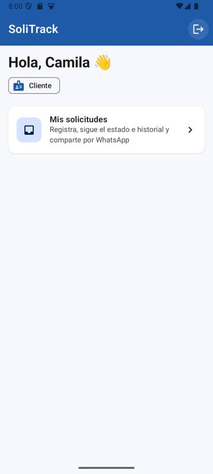 | 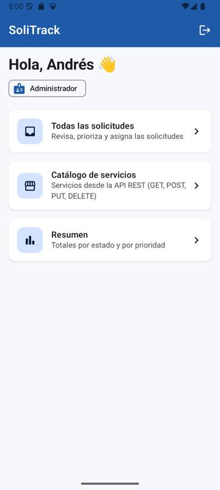 | 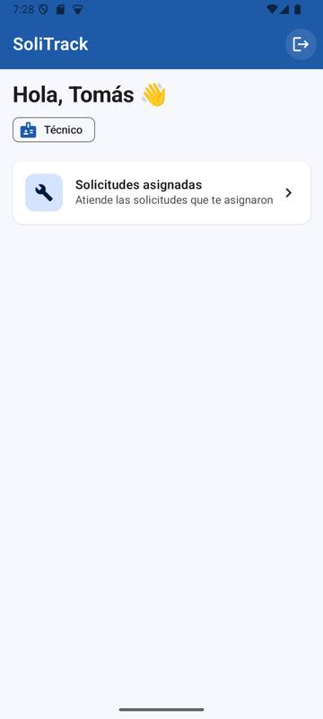 |

**Seguimiento**

| Detalle (cliente) | Compartir por WhatsApp | Gestión del administrador |
|:---:|:---:|:---:|
| 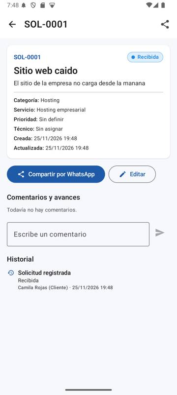 | 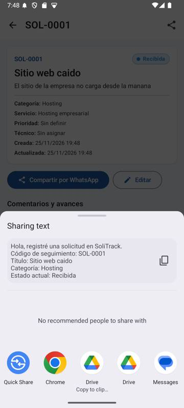 | 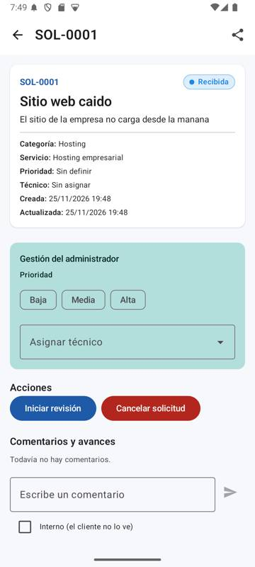 |
| **Técnico: en proceso** | **El cliente no ve comentarios internos** | **Historial completo** |
| 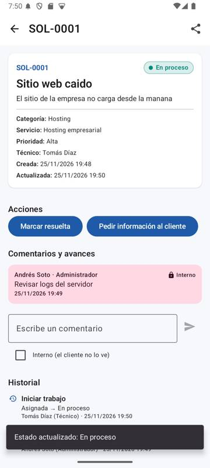 | 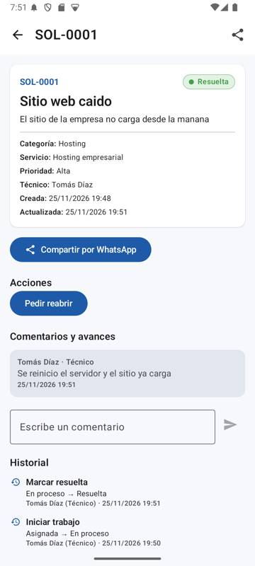 | 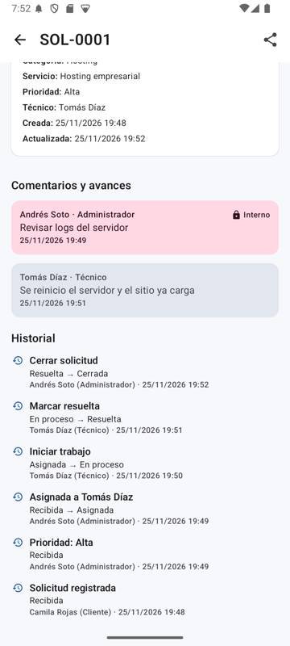 |

**Administración y API**

| Búsqueda y filtros | Resumen por estado | Catálogo desde la API |
|:---:|:---:|:---:|
| 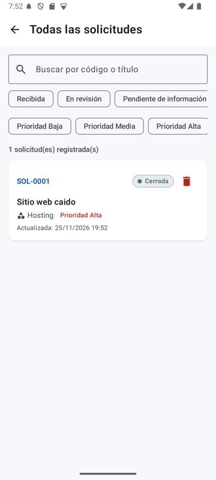 | 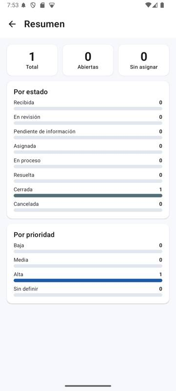 | 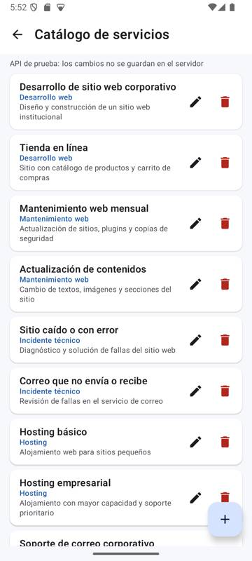 |

**Entrega anterior (Parcial 2)**

| Inicio de sesión | Validaciones | Registro |
|:---:|:---:|:---:|
| 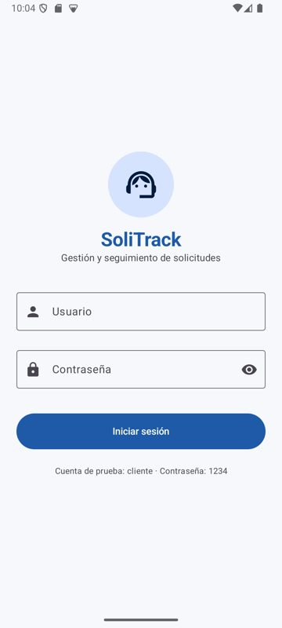 | 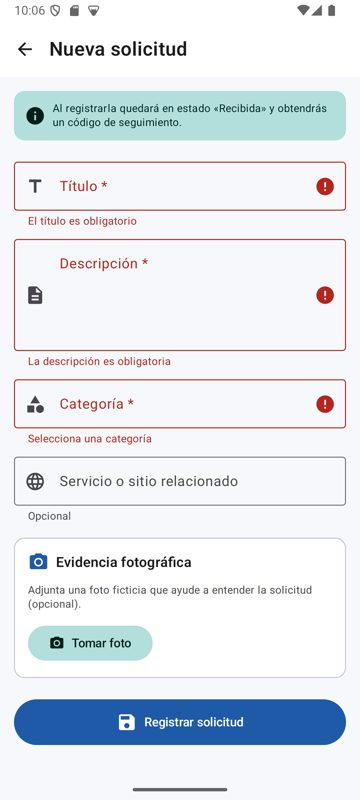 | 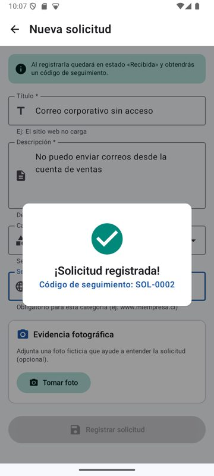 |
| **Lista de solicitudes** | **Evidencia con cámara** | **Notificación local** |
| 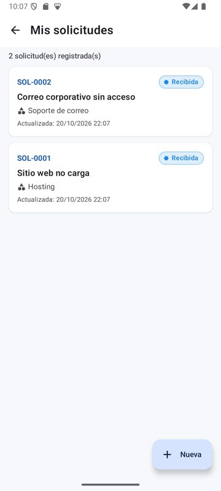 | 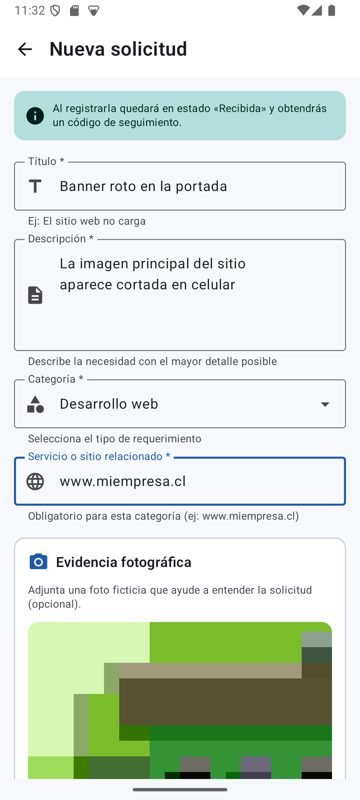 | 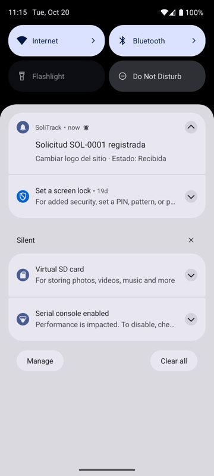 |
