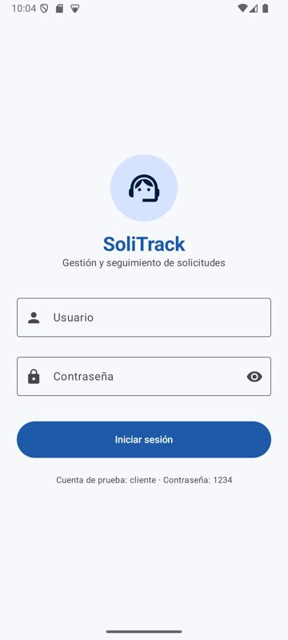
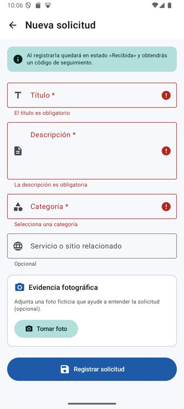
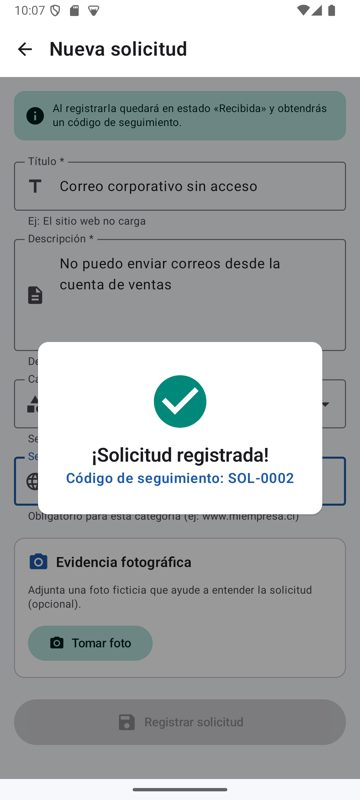
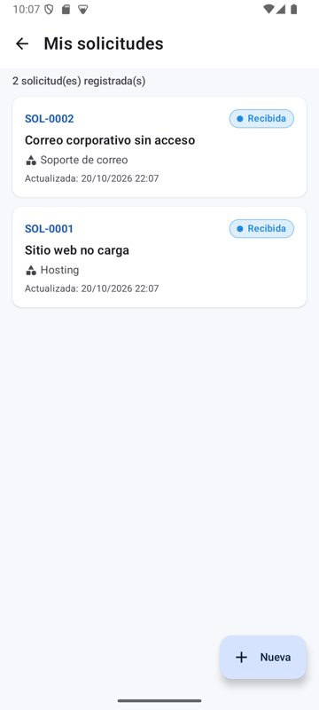
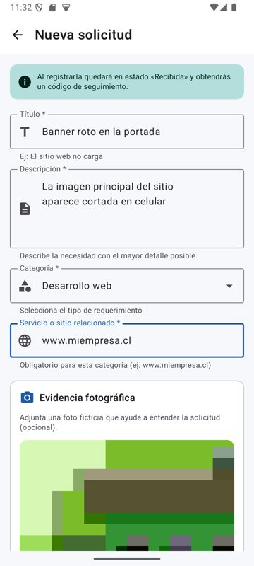
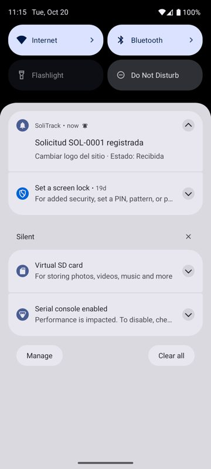

# SoliTrack 📋

Aplicación móvil Android para la **gestión y seguimiento de solicitudes de clientes** de una pequeña empresa de servicios informáticos y digitales.

Proyecto de la asignatura **DSY1105 – Desarrollo de Aplicaciones Móviles** (Duoc UC, sección 009V) · Evaluación Parcial 2.

## 👥 Integrantes

| Nombre | Rol principal |
|---|---|
| Fernando Arce | Datos y lógica: Room, Repository, ViewModel, validaciones, pruebas, notificaciones |
| Raúl Barraza | Interfaz: tema, login, menú, navegación, formulario, cámara, animaciones |

## 🎯 Problema que resuelve

Los clientes envían sus solicitudes por WhatsApp y estas se pierden en conversaciones extensas: no quedan registradas formalmente, no tienen código, estado ni evidencia. SoliTrack permite **registrar cada solicitud con un código único de seguimiento** y mantenerla disponible para su consulta.

Esta entrega implementa el **módulo de Solicitudes**, según los lineamientos de la primera entrega.

## ✅ Funcionalidades implementadas

- [x] Inicio de sesión con cuenta ficticia y validación de campos
- [x] Menú principal y cierre de sesión
- [x] Listado de solicitudes guardadas (código, título, categoría y estado con color)
- [x] Registro de nuevas solicitudes con:
  - Título, descripción, categoría y servicio relacionado
  - Validaciones visuales por campo (borde, ícono y mensaje de error)
  - Servicio relacionado obligatorio solo cuando la categoría lo requiere
  - Código único autogenerado (SOL-0001, SOL-0002, …)
  - Estado inicial **"Recibida"** y fecha/hora de creación
- [x] Edición de solicitudes existentes (conserva código, estado y fecha de creación)
- [x] Persistencia local con **Room** (los datos se mantienen al reiniciar la app)
- [x] Lista reactiva: se actualiza automáticamente al registrar o modificar
- [x] Animaciones: transiciones entre pantallas, errores animados, confirmación al guardar y aparición de tarjetas
- [x] Pruebas unitarias de las reglas de validación (12 pruebas JUnit)

### 📱 Recursos nativos

| Recurso | Uso en la app | Permiso |
|---|---|---|
| **Cámara** | Captura una foto ficticia como evidencia y la vincula a la solicitud. La foto se guarda en la carpeta privada de la app mediante `FileProvider`. | `CAMERA`, solicitado al presionar "Tomar foto" |
| **Notificaciones locales** | Avisa cuando una solicitud se registra o se modifica ("Solicitud SOL-0001 registrada"). Al tocarla se abre la app. | `POST_NOTIFICATIONS` (Android 13+), solicitado al entrar a la lista |

Si el usuario rechaza un permiso, la app sigue funcionando: no abre la cámara o no muestra avisos, pero no se cierra.

## 🛠️ Tecnologías

- Kotlin + Jetpack Compose + Material Design 3
- Arquitectura **MVVM** (View → ViewModel → Repository → DAO → Room)
- `StateFlow` + `UiState` para la gestión de estado
- Room (persistencia local) con KSP
- Navigation Compose
- Coil (visualización de imágenes)
- JUnit (pruebas unitarias)
- Git + GitHub (ramas y pull requests) · Trello

## 📁 Estructura del proyecto

```
com.example.solitrack
├── MainActivity.kt
├── SoliTrackApp.kt
├── data
│   ├── local        → SolicitudEntity, SolicitudDao, AppDatabase (Room)
│   ├── model        → Categoria, EstadoSolicitud
│   └── repository   → SolicitudRepository, AuthRepository
└── ui
    ├── login        → LoginScreen, LoginUiState, LoginViewModel
    ├── menu         → MenuScreen
    ├── solicitud    → ListaSolicitudesScreen, SolicitudFormScreen,
    │                  SolicitudUiState, SolicitudViewModel, SolicitudValidator
    ├── navigation   → AppNavigation
    ├── components   → EstadoChip, CamaraUtils, NotificacionUtils
    └── theme        → Color, Theme, Type
```

## ▶️ Cómo ejecutar

**Requisitos:** Android Studio reciente (2025.1 Narwhal o superior, compatible con Android Gradle Plugin 8.12) con **JDK 17 o 21** configurado como *Gradle JDK* (Settings → Build Tools → Gradle).

1. Clonar el repositorio:
   ```
   git clone https://github.com/Fiek4/SoliTrack.git
   ```
2. Abrir la carpeta en **Android Studio** y esperar la sincronización de Gradle.
3. Ejecutar en un emulador o dispositivo con **Android 7.0 (API 24)** o superior.
4. Iniciar sesión con la cuenta de prueba:
   - Usuario: `cliente`
   - Contraseña: `1234`
5. Aceptar los permisos de notificaciones y cámara cuando la app los solicite.

Para correr las pruebas unitarias: clic derecho en `app/src/test/.../SolicitudValidatorTest.kt` → **Run**.

> Todos los datos, usuarios e imágenes de la app son **ficticios**.

## 📋 Planificación

Tablero de Trello: https://trello.com/b/huUjbndt/solitrack-dsy1105

## 📸 Capturas

| Inicio de sesión | Validaciones | Registro |
|:---:|:---:|:---:|
|  |  |  |
| **Lista de solicitudes** | **Evidencia con cámara** | **Notificación local** |
|  |  |  |
